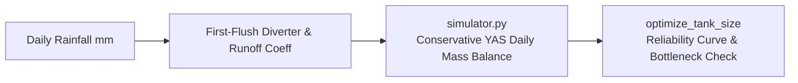

# rainharvest-opt

[](https://github.com/codesphere-u/rainharvest-opt/actions/workflows/ci.yml)
[](LICENSE)
[](pyproject.toml)
[](pyproject.toml)

**Zero-dependency Yield-After-Spillage (YAS) rainwater harvesting tank simulator, first-flush diverter sizing, dry-season reliability auditor, and optimal cistern-size curve optimizer.**

- **Mission Domain:** Water Security, Civil Engineering & WASH
- **Stack:** Pure Python 3.11+ (zero runtime third-party dependencies, `mypy --strict`, `ruff`, `pytest`)
- **Maintainer:** Codesphere Innovations (U) Limited (`codesphere-u`)

---

## Problem Solved

Rural schools, clinics, and households routinely install undersized rainwater tanks that run dry mid-dry-season—or oversized tanks constrained by small roofs—because cisterns are guessed instead of simulated with daily mass balance.

## Key Features

- Conservative Fewkes & Butler Yield-After-Spillage (`simulate_yas_tank`) daily mass-balance engine with roof material runoff coefficients (`corrugated_iron`, `glazed_tile`, `concrete_slab`, `asphalt_shingle`).
- Automatic first-flush roof-wash diverter sizing (`1 mm` per event) protecting cistern water quality.
- Optimal tank-size curve builder (`optimize_tank_size`) reporting volumetric & time reliability, longest consecutive dry-out streak, spillage %, and roof-area bottleneck warnings.

## Architecture Overview



See [docs/architecture.md](docs/architecture.md) for module-level design details.

## Installation

```bash
git clone https://github.com/codesphere-u/rainharvest-opt.git
cd rainharvest-opt
uv sync --extra dev
```

Or install in editable mode with standard `pip`:

```bash
pip install -e ".[dev]"
```

## Quick Start (CLI)

```bash
rainharvest-opt --roof-m2 220 --demand-liters 320 --target-reliability 90
```

## Quick Start (Python API)

```python
from rainharvest_opt import CatchmentSpec, simulate_yas_tank

res = simulate_yas_tank(CatchmentSpec(150.0, 300.0), [15.0, 0.0] * 180, tank_capacity_liters=20000.0)
assert res.volumetric_reliability_pct > 80.0
```

## Testing & Quality Gates

```bash
uv run ruff check src tests
uv run mypy src
uv run pytest -v
```

## Security, Contributing & Roadmap

- **Security:** See [SECURITY.md](SECURITY.md) for responsible disclosure procedures.
- **Contributing:** See [CONTRIBUTING.md](CONTRIBUTING.md) and [CODE_OF_CONDUCT.md](CODE_OF_CONDUCT.md).
- **Changelog & Roadmap:** See [CHANGELOG.md](CHANGELOG.md) and [ROADMAP.md](ROADMAP.md).

## License

MIT License — see [LICENSE](LICENSE).

## Support & Contact

Open an issue on [GitHub Issues](https://github.com/codesphere-u/rainharvest-opt/issues) or contact `codesphereinnovationz@gmail.com`.
